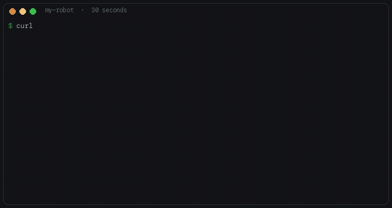

# Demo — what 30 seconds gets you

Scenario: a brand-new Node project, no tests wired, `.cursor/rules` exists but is empty.



The GIF is a real first-run apply (2026-08-17), same table the GitHub `main` curl one-liner prints on a fresh Node app.

## Curl one-liner (verified against GitHub `main`)

Prefer clone. If you use the fetch, **read the script first** and start with `--dry-run`:

```bash
curl -fsSL https://raw.githubusercontent.com/noidsoup/my-robot/main/bootstrap.sh | bash -s -- --dry-run
```

Checked 2026-08-17 against GitHub `main` in an isolated Node sample (`git:0 node:1 python:0`):

- Exit 0
- Statuses are `would-write` / `would-link` / `would-ensure` (not `installed`)
- Target directory unchanged after dry-run
- Apply wrote `.verify.sh`, rules, wiki vault, memory stubs

Standalone mode fetches templates into `~/.my-robot` (or `$MY_ROBOT_HOME`) when the script has no sibling `template/` directory. Put `MY_ROBOT_HOME` on **bash**, not on `curl`.

A re-run reports `existed` and skips. Installer helper scripts (`wiki-lint.py`, LanceDB) do not flip a Node app into “Python.”

## Apply transcript

```console
$ curl -fsSL https://raw.githubusercontent.com/noidsoup/my-robot/main/bootstrap.sh | bash -s --
== my-robot bootstrap ==
target:  /tmp/sample-app
git:0  node:1  python:0  go:0  cursor:1  claude:0

WARN: not a git repo — proceeding anyway

LAYER                STATUS         DETAIL
-----                ------         ------
L0 Ground Truth      generated      .verify.sh: npm run lint, npm run test
L0.5 Env Parity      installed      .env.example stub
L1 Retrieval         note           non-Python: docs/ai-retrieval.md explains Python-sidecar option
L2 Constraints       installed      .cursor/rules (3 new, 0 existed, 0 failed)
L3 Workflows         installed      .loops -> ~/.loops (symlink, auto-updates)
L4 Knowledge Wiki    installed      sample-app wiki/ (open in Obsidian as vault)
L5 Continuity        installed      memory stubs (2 new, 0 existed, 0 failed)
AGENTS.md            installed      minimal stub — ask your agent to fill stack + invariants

Done.
```

Dry-run on a fresh target reports `would-write` / `would-link` instead of `installed`. A re-run reports `existed` and skips — including L1.

From here, open Cursor or Claude Code in that repo and say **"use the loops"** — the agent routes through the [loops](https://github.com/noidsoup/loops) dispatcher, searches before it acts (pre-task-retrieval rule), and runs `.verify.sh` before declaring anything done.
